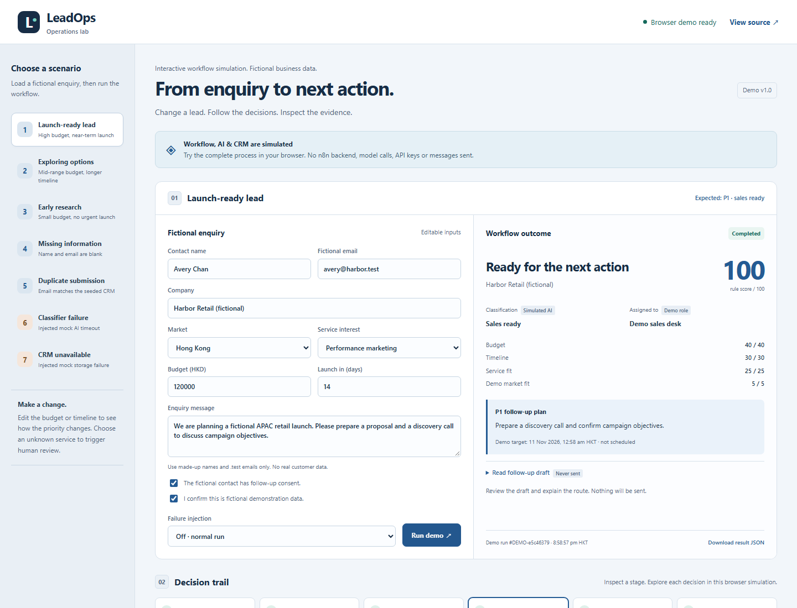
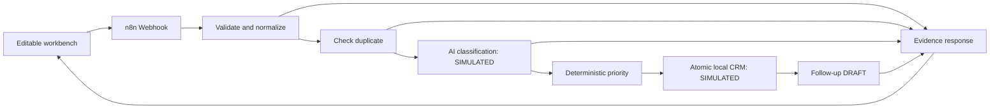
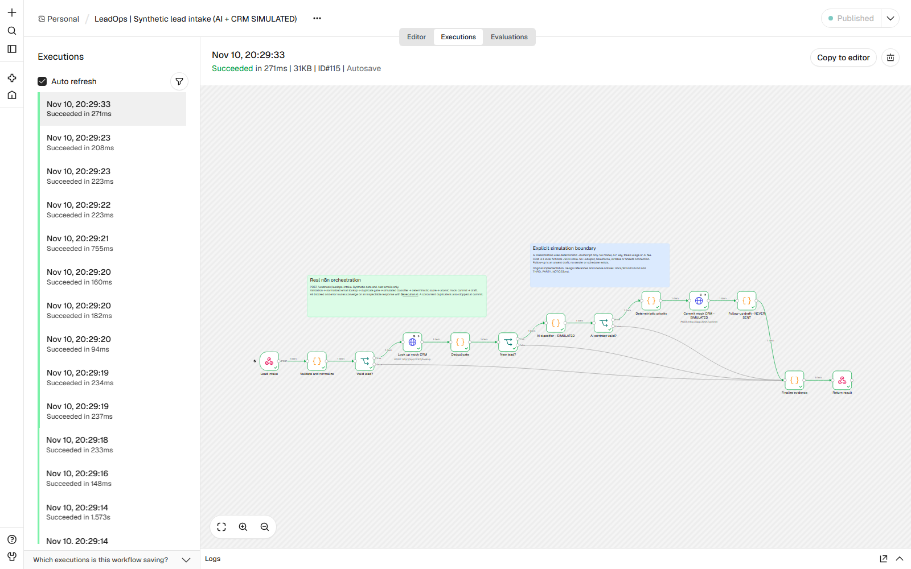

# LeadOps: an interactive automation demo

An enquiry arrives. Is it complete? Is it already in the CRM? Who should follow up, and why?

LeadOps turns those questions into an editable workbench with seven fictional scenarios, explicit failure handling and an inspectable decision trail. It includes a standalone website and an importable n8n workflow.

**[Open the interactive demo](https://n8n-leadops-demo.k1628707369.workers.dev)** — no login, installation or running local computer required.

**Standalone website:** the complete workflow, AI and CRM are simulated in the visitor's browser. No n8n server is connected, nothing is submitted to an API, and each tab has its own temporary fictional CRM. Reload or reset restores the seed. The website works independently of the developer's computer.

**Local Docker version:** n8n orchestration runs for real, while AI uses deterministic JavaScript, CRM is a local fictional JSON store and follow-ups are unsent drafts. Neither version calls a model, requires an AI API key or sends messages. Confidence values, score weights and response targets are illustrative demo policy.



## Standalone website

The website reuses the same validation, classification and scoring functions as the n8n workflow, with an in-memory browser adapter. It does not claim to execute n8n. No Docker, account or backend is needed to use the published website. Inputs remain in the current tab; no analytics or external API is connected.

To build and verify the website:

```sh
npm ci
npm run build:site
npx playwright install chromium
npm run test:site
```

To deploy to your Cloudflare account with the official Wrangler CLI installed and authenticated:

```sh
npm run build:site
wrangler deploy
```

`wrangler.jsonc` uploads only the allowlisted `dist/` assets using Cloudflare Workers Static Assets. There is no Worker API, database binding, n8n server or model service. `dist/_headers` blocks fetch/XHR connections via CSP. The deploy command updates the named Cloudflare site; GitHub pushes alone do not redeploy it. [Official static-assets documentation](https://developers.cloudflare.com/workers/static-assets/).

## What to inspect

- **Operational design:** validation and normalized-email deduplication happen before classification; atomic commit also prevents concurrent duplicates.
- **AI integration contract:** a visible, versioned input/output boundary with a malformed-output failure case. Model inference is deliberately simulated.
- **Business decisions:** a transparent 0–100 rule score, priority, demo owner, human-review route and follow-up target.
- **Reliability:** blocked cases, simulated service failures, safe retries, a real n8n execution ID and downloadable response JSON.
- **Verification:** unit tests, actual webhook tests, isolated browser checks, automated accessibility checks and genuine screenshots. No claims about real conversion uplift or measured staff time savings.

## Run the local n8n version

Requires Docker Desktop using Linux containers / WSL2 on Windows, or Docker Engine with Compose v2+. No Node.js or npm install is needed just to run the demo.

From the project folder in Windows PowerShell:

```powershell
powershell.exe -NoProfile -ExecutionPolicy Bypass -File .\scripts\start.ps1
```

On macOS / Linux:

```sh
sh scripts/start.sh
```

Open [the workbench](http://localhost:3000) and [the n8n editor](http://localhost:5678/workflow/LeadOpsDemoV1). Both bind to **127.0.0.1 only**. The startup script builds the app, imports the workflow on first use, publishes it and restarts n8n. Ordinary restarts preserve editor changes and stored data.

The workbench works without an n8n editor login. On a fresh installation, open n8n and complete its owner setup with local demo details. No provider account or API key is needed. Local credentials and runtime data must stay out of version control.

To stop while retaining data:

```sh
docker compose stop
```

To resume, use the startup script again. **Reset demo data** in the UI restores one mock CRM seed record; it does not erase n8n history. Named Docker volumes hold n8n's SQLite database / generated encryption key and the mock CRM. Avoid `docker compose down -v` when you want to retain them. Docker Desktop may need to be started after a Windows reboot.

## Try the workflow

1. Click **Reset demo data**, choose **Launch-ready lead**, then **Run lead workflow**. Inspect the 100/100 P1 decision, mock CRM record and unsent draft.
2. Click a stage in **Decision trail**, then expand **Simulated AI input & output** to inspect the contract and actual n8n execution ID.
3. Choose **Missing information** and **Duplicate submission**. Both stop before AI. The duplicate uses a seeded uppercase / whitespace email to demonstrate normalization.
4. Choose **CRM unavailable**. Show that no record or follow-up draft was created. Change **Failure injection** to **Off** and rerun to recover safely.
5. Open n8n → **Executions** and inspect the corresponding run. A handled business failure can still have a successful n8n execution status: the response's `status` and stage evidence record the business outcome.

For an interactive variation, reset, load the launch-ready lead and change its budget to HKD 35,000 and timeline to 60 days: the deterministic score becomes 65 and P2. Select **Unknown / needs review** to route it to a human. Replaying a successful email without resetting intentionally produces a duplicate.

## Cases and expected results

| Preset / control | HTTP | Business outcome | AI step | New CRM record | Follow-up |
| --- | --- | --- | --- | --- | --- |
| Launch-ready lead | 200 | P1, score 100, sales ready | Simulated | Yes, local | Draft only |
| Exploring options | 200 | P2, score 65, nurture | Simulated | Yes, local | Draft only |
| Early research | 200 | P3, score 25, nurture | Simulated | Yes, local | Draft only |
| Missing information | 422 | Validation blocked | Skipped | No | None |
| Duplicate submission | 409 | Duplicate prevented | Skipped | No | None |
| Classifier failure | 502 | Injected mock timeout | Failed simulation | No | None |
| CRM unavailable | 503 | Injected mock commit failure | Simulated | No | None |
| Malformed mock AI output | 502 | Contract rejected | Failed simulation | No | None |
| Unknown service | 200 | Human review | Simulated | Yes, local | Review draft |

All fixtures are invented. Use `.test` emails, made-up names and the explicit fictional-data confirmation. This declaration is an operator safeguard, not an automated detector of real personal data. Never paste real customer data.

## How it works



The workflow has 13 executable nodes plus two explanatory notes. n8n performs the orchestration and business decisions. The small Node app serves static HTML/CSS/JS, proxies the request, and exposes mock CRM lookup/commit on a separate **unpublished** container port. The browser never fabricates stage progress. It displays the completed workflow response, including skipped stages.

Two images are pinned by version and digest: official n8n **2.47.3** and Node **24.22.1**. No production npm dependencies. The Compose bridge permits outbound networking, but the workflow's only HTTP Request nodes point at `http://app:3001/lookup` and `/commit`. No caller-supplied URLs are fetched. n8n diagnostics, version notifications, templates, community-package installation and the MCP registry are disabled. This is a local demonstration, not a public production deployment.

### Import and edit the workflow

The credential-free import is [workflows/leadops.json](workflows/leadops.json). Use n8n's **Import from File**, or the documented server CLI:

```sh
docker compose exec -T n8n n8n import:workflow --input=/demo/workflows/leadops.json
docker compose exec -T n8n n8n publish:workflow --id=LeadOpsDemoV1
docker compose restart n8n
```

Importing alone into an unrelated n8n instance is not self-contained: the two mock CRM HTTP nodes depend on this Compose app service. Keep the full stack, or explicitly change those mock endpoints. The export defaults to unpublished; startup publishes it locally. The production webhook is `/webhook/leadops-intake`, not `/webhook-test/...`.

Business logic is in `workflow/logic.mjs`. `npm run generate` embeds those exact functions into n8n Code nodes; `npm run check` detects drift. To deliberately replace local editor changes with the checked-in workflow, set `LEADOPS_REIMPORT=1` for one startup.

## Verify it

Node.js 24+ is needed only for development/testing:

```sh
npm ci
npm test
npm run check
npm run test:integration
npx playwright install chromium
npm run test:browser
npm audit
```

The live integration/browser tests reset **this demo's mock CRM**, run fictional cases and restore the seed; they retain n8n execution history. `scripts/capture-n8n.mjs` optionally captures the actual n8n editor and an execution, using the ignored local demo-owner file. It does not reset an existing owner account.

Verified: **20 unit tests**, **19 standalone website browser checks**, plus **21 actual n8n integration checks and 18 local n8n browser checks**. Coverage includes the seven presets, recovery, editing, JSON download, independent browser sessions, hostile-text escaping and responsive layouts. The standalone audit also verifies zero API requests. Automated axe checks found no WCAG 2.1 AA violations on the audited screens; that does not replace a full manual accessibility audit. See [verification record](docs/VERIFICATION.md) and [machine-readable evidence](docs/evidence/).



## Files worth reading

| Path | Purpose |
| --- | --- |
| `workflows/leadops.json` | Importable n8n workflow; no credentials |
| `workflow/logic.mjs` | Validation, mock AI, scoring and recovery logic |
| `app/crm.mjs` | Local atomic fictional record store |
| `fixtures/` | Seven presets and one CRM seed |
| `docs/SOURCES.md` | Actual workflows reviewed, exact revisions and selection decisions |
| `THIRD_PARTY_NOTICES.md`, `licenses/` | Reference licensing and dependency notices |
| `docs/screenshots/` | Unedited captures from the real local apps |
| `docs/AI-CONTRACT.md` | Versioned mock-classifier interface and decision rules |
| `site/`, `scripts/build-site.mjs`, `wrangler.jsonc` | Independent browser simulation and Cloudflare static deployment |

## Limitations

This proves workflow design and operational handling, **not real model quality or real CRM integration**. Email is the only deduplication identity. The mock CRM is a bounded single-process JSON store (500 records), not a multi-user database. A response target is calculated and displayed, not scheduled or enforced. There is no background follow-up, email delivery, distributed transaction, approval system or semantic prompt-injection evaluation. The application has no login because it is restricted to localhost; do not expose or tunnel it publicly.

Original project code is [MIT](LICENSE). **n8n is fair-code under its Sustainable Use License with separate enterprise terms**, not part of this project's MIT grant. Reference workflows and dependencies retain their own notices. [Research and attribution](docs/SOURCES.md) distinguish design inspiration from reused code.
